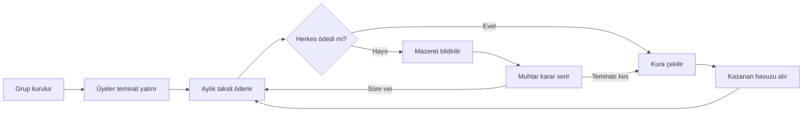

<div align="center">

# 🪙 CommonFund

**Kurayı da kasayı da şirket değil, kod yönetsin.**

Arkadaş grupları için faizsiz, şeffaf ve yapay zekâ hakemli ortak birikim sistemi.
Monad üzerinde çalışır.


[🌐 Canlı demo](<DEMO_LINKI>) · [📜 Kontrat](<EXPLORER_LINKI>) · [🎥 Demo videosu](<VIDEO_LINKI>)


</div>

---

## 💡 Sorun

Arkadaşlarınla birlikte biriktirip sırayla büyük bir şey (Araba, telefon, Laptop) almak isteyebilirsin.
Bu "altın günü" mantığı yüzyıllardır var, ama iki sorunu hiç çözülmedi:

- **Parayı kim tutacak?** Havuzu tutan kişiye ya da kuruma güvenmek zorundasın.
- **Biri ödemeyi bırakırsa ne olacak?** Parayı alan kaçarsa kalanlar mağdur olur.
- **Kura gerçekten adil mi?** Sonucu herkes göremez, itiraz edemez.

## ✅ Çözüm

CommonFund'da para bir akıllı kontratta durur. Kurallar herkesin görebildiği koddur:

1. Üyeler gruba katılırken **teminat** kilitler.
2. Her ay herkes **eşit taksit** yatırır.
3. Her ay havuzu **kura ile bir üye** alır (daha önce almamış olanlar arasından).
4. Parayı alıp ödemeyi bırakanın **teminatı otomatik kesilir**.
5. Üç yapay zekâ agent'ı sistemi yönetir, ama **parayı hiçbiri çekemez**.

## ⚙️ Nasıl çalışır?



## 🤖 Agent'lar

| Agent | Rolü | Neyi yapamaz? |
|---|---|---|
| **Muhtar** | Hakem. Mazereti okur, "süre ver" veya "teminatı kes" kararını verir. | Zamanında ödeyen birine ceza veremez, havuzdan para çekemez. |
| **Kâtip** | Doğal dildeki isteği (ör. "5 kişi, ayda 10 token") kontrat parametrelerine çevirir, durumu özetler. | Hiçbir işlemi kendisi imzalayamaz. |
| **Bekçi** | Gecikenleri izler ve uyarır. | Yalnızca okur ve bildirir. |

> Agent'lara karar yetkisi veriyoruz, ama **sınırları kontrat çiziyor**.

## 🔗 Neden blockchain olmasa olmazdı?

| Geleneksel sistem | CommonFund |
|---|---|
| Parayı bir kişi veya şirket tutar | Parayı kontrat tutar, kimse tek başına çekemez |
| Kura sonucuna güvenmek gerekir | Sonuç zincirde herkesin görebildiği bir işlemdir |
| Teminat kesintisi insan kararına bağlıdır | Kesinti kod tarafından, kurala göre uygulanır |
| Yapay zekâya hesap açılamaz | Agent'ın kendi cüzdanı var, yetkisi kodda yazılı |

## 🧱 Mimari

```
┌──────────────┐     ┌────────────────┐     ┌───────────────────┐
│  Next.js UI  │ ──► │  Agent API     │ ──► │  Monad testnet    │
│  (wagmi)     │     │  (Muhtar,      │     │  CommonFund.sol   │
│              │ ◄── │   Kâtip,Bekçi) │ ◄── │                   │
└──────────────┘     └────────────────┘     └───────────────────┘
```

## 🛠️ Teknoloji

- **Ağ:** Monad testnet (chain id `10143`)
- **Kontrat:** Solidity 0.8.x
- **Arayüz:** Next.js, TypeScript, wagmi, viem
- **Agent'lar:** <KULLANDIĞIN MODEL/API>

## 🧪 Jüri için: sistemi dene

1. [Canlı demoyu](<DEMO_LINKI>) aç.
2. **"Demoyu dene"** düğmesine bas. Hazır bir grup açılır (5 demo cüzdanı).
3. Cüzdanlar arasında geçiş yap ("Ayşe olarak devam et" gibi), taksit öde, kura çek.
4. Bir üye ile ödemeyi bırakıp **mazeret yaz**, Muhtar'ın kararını izle.
5. **Doğrulama** sayfasından kontrat adresini ve işlemleri explorer'da kontrol et.

> Demo için dönem süresi kısaltılmıştır. Demo cüzdanları yalnızca testnet içindir, gerçek varlık taşımaz.

## 🚀 Yerelde çalıştırma

```bash
git clone <REPO_LINKI>
cd <KLASÖR_ADI>
npm install
cp .env.example .env.local   # değerleri doldur
npm run dev
```

`.env.local` içinde şunlar gerekir:

| Değişken | Açıklama |
|---|---|
| `NEXT_PUBLIC_CONTRACT_ADDRESS` | Deploy edilen kontrat adresi |
| `AGENT_API_KEY` | Agent'lar için model API anahtarı |
| `ARBITER_PRIVATE_KEY` | Muhtar'ın testnet cüzdan anahtarı (**gerçek varlık koyma**) |

## ⚠️ Bilinen sınırlar

Dürüst olmak gerekirse bu bir hackathon prototipi:

- Kura rastgeleliği demo için basit bir yöntemle üretiliyor. Gerçek ürün için doğrulanabilir rastgelelik gerekir.
- Muhtar kararları bugün tek bir hakem adresine bağlı. Sonraki adım itiraz ve çoklu hakem mekanizması.
- Yalnızca testnet'te çalışır, gerçek para veya konut finansmanı vaat etmez.


## 👥 Takım

| Berat Varlık | Full Stack Developer|
|---|---|
| <İsim> | <Rol> |

